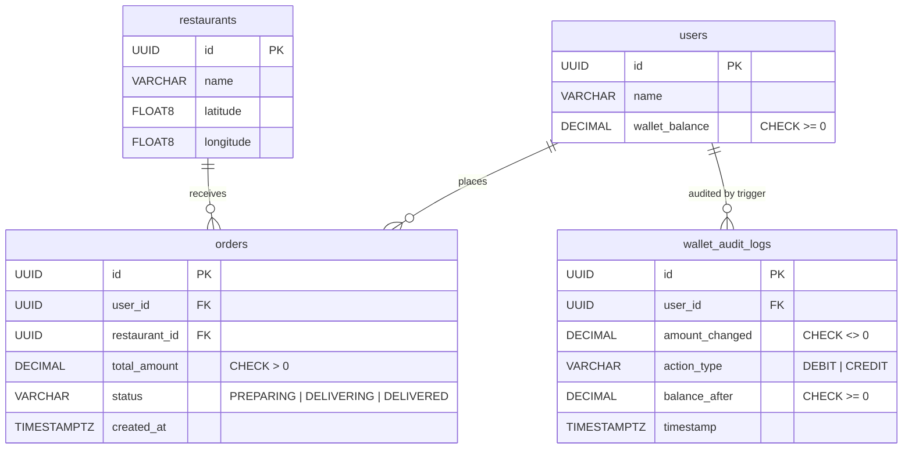

# BiteStream Database: Complete Guide

*Author: Aditya Chintala (Team 9, database verification). Last verified: 2026-10-14 on
PostgreSQL 18.6 and MongoDB 8.0.34.*

This document explains the BiteStream data layer end to end:
- what it does and why each piece is built the way it is
- what was wrong with the version we inherited, and how it was fixed
- how to prove each claim with a command
- questions you're likely to be asked about it

Read §1 for the 60-second version, §11 for interview practice, and the rest when you need depth.

---

## Contents

1. [The 60-second pitch](#1-the-60-second-pitch)
2. [Context: what this project is](#2-context-what-this-project-is)
3. [Architecture: why two databases](#3-architecture-why-two-databases)
4. [PostgreSQL in depth](#4-postgresql-in-depth)
5. [MongoDB in depth](#5-mongodb-in-depth)
6. [Data generation (seeding)](#6-data-generation-seeding)
7. [Performance proof](#7-performance-proof)
8. [What we inherited, what was wrong, what we changed](#8-what-we-inherited-what-was-wrong-what-we-changed)
9. [Spec compliance matrix](#9-spec-compliance-matrix)
10. [How to run and verify everything](#10-how-to-run-and-verify-everything)
11. [Interview questions and answers](#11-interview-questions-and-answers)
12. [Known limitations and what I would do next](#12-known-limitations-and-what-i-would-do-next)
13. [Glossary](#13-glossary)

---

## 1. The 60-second pitch

> BiteStream is a food-delivery backend split across **PostgreSQL** and **MongoDB**. Money and
> orders live in Postgres, because they need ACID transactions, constraints and an audit trail.
> Menus, reviews and high-volume driver GPS pings live in Mongo, because they're
> schema-flexible, document-shaped or geospatial.
>
> The core is an **atomic checkout stored procedure**. It runs its own REPEATABLE READ
> transaction, locks the user's wallet row, and debits it. A **CHECK constraint** forbids
> negative balances, and a **trigger** writes an immutable audit row. It then inserts the
> order, where a **partial unique index** allows only one active order per user, and commits.
> On any failure it catches the error, rolls back, and raises a clear error code.
>
> On top of that: a **window-function query** (7-day moving average plus `DENSE_RANK`), a
> **materialized view** refreshed concurrently, a **`$geoNear`** pipeline for the nearest
> drivers (2dsphere index, 2-hour TTL), and a **`$facet`** pipeline for review analytics.
>
> We inherited this from another team. I verified it against the spec, found that the seed
> data made most features un-demoable (all orders on one day, restaurants scattered across the
> globe, half the GPS pings expiring instantly, no shared keys between the two databases),
> plus four spec deviations. I fixed all of them and backed each claim with EXPLAIN plans
> and tests. Every heavy query now uses an index, with no sequential or collection scans.

---

## 2. Context: what this project is

- **Course:** CS6.302 Software System Development (IIIT Hyderabad), Monsoon 2026.
- **Assignment 1 (A1), done by another team:** design a "production-grade" database for one of five
  projects using PostgreSQL + MongoDB only, with no application code. Ours is **Project 1:
  BiteStream: Food Delivery & Real-Time Logistics** (spec: `assign1_ssd_v1.pdf`, pages 3–4 and 8).
- **Assignment 1B / 2 (A1B), our team:** teams were reshuffled and each inherited someone
  else's A1 repo. We must make it run, fix it, document the handover, then build an API and a
  web front end on top (spec: `Assignment1b.pdf`).
- **My role:** database verification. Check the inherited schema, procedures, pipelines and
  seed data against the A1 spec, fix what's wrong, and make sure the backend developer (Vedant)
  gets correct, reproducible data when he seeds his own machine. Frontend is Anuj.

The A1 spec in one table (what was asked → where it lives now):

| Spec requirement | Implemented in |
|---|---|
| Tables `users`, `wallet_audit_logs`, `restaurants`, `orders` with the given columns and CHECKs | `sql/01_schema_ddl.sql` |
| Collections `Menus`, `Reviews`, `DriverPings` | `mongo/01_collections_and_indexes.js` |
| Trigger AFTER UPDATE OF `wallet_balance` → immutable audit row | `sql/03_triggers_and_audit.sql` |
| Partial unique index: one active delivery per user | `sql/02_indexes.sql` |
| Materialized view: restaurants + completed order count + revenue, with a REFRESH CONCURRENTLY function | `sql/05_materialized_views.sql` |
| 2dsphere on `DriverPings.location`, TTL 7200 s on `created_at` | `mongo/01_collections_and_indexes.js` |
| WF1: `sp_execute_checkout` (REPEATABLE READ, debit, insert order, COMMIT; catch + ROLLBACK) | `sql/04_stored_procedures.sql` |
| WF2: CTEs + window functions: 7-day moving average per restaurant, `DENSE_RANK` | `sql/06_window_analytics.sql` |
| WF3: `$geoNear`: closest active driver within 5 km of a restaurant | `mongo/02_workflow3_geonear.js` |
| WF4: `$facet`: rating distribution, top tags via `$unwind`, average rating | `mongo/03_workflow4_facet.js` |
| ≥100k ledger rows, ≥50k orders, ≥500k pings | `data_generation/*.py` |
| ERD, Mongo schema map, EXPLAIN / executionStats | `docs/relational_erd.png`, `docs/mongo_schema_map.json`, `performance/` |

---

## 3. Architecture: why two databases

This is called **polyglot persistence**: use each database for what it is good at.

```
                  ┌───────────────────────── PostgreSQL ─────────────────────────┐
  checkout ──────►│ users ──1:N── orders ──N:1── restaurants                     │
  (WF1)           │   │  wallet_balance CHECK >= 0        lat / lng               │
                  │   └─ trigger ──► wallet_audit_logs (insert-only)              │
  analytics ─────►│ 06_window_analytics.sql (WF2) · mv_restaurant_revenue_summary │
                  └───────────────────────────────────────────────────────────────┘
                         ▲ shared key: restaurant_id / user_id (UUID as string)
                  ┌──────┴────────────────── MongoDB ────────────────────────────┐
  menu / reviews ►│ Menus (nested catalog) · Reviews ── $facet (WF4)             │
  map ───────────►│ DriverPings (GeoJSON, 2dsphere, TTL 2 h) ── $geoNear (WF3)   │
                  └───────────────────────────────────────────────────────────────┘
```

| Data | Where | Why |
|---|---|---|
| Wallet balances, orders, audit trail | PostgreSQL | Money needs **atomic multi-row transactions**, **constraints** (no negative balance), **foreign keys**, and a trustworthy audit trail. These are relational strengths. |
| Menus | MongoDB | Each restaurant's menu is a **nested tree** (categories → items → add-ons) with **different shapes per restaurant**. Normalizing it into 4–5 tables gains nothing; the UI reads it as one document. |
| Reviews | MongoDB | Append-only, read in aggregate. **`$facet`** computes several aggregations in one pass. |
| Driver pings | MongoDB | **High write volume**, **geospatial** queries (`2dsphere`, `$geoNear`), and **automatic expiry** (TTL index). Old GPS points are worthless after a few hours. |

**How the two databases connect:** they don't, at the database level. There is no
cross-database foreign key. Mongo documents store the Postgres UUID as a string
(`restaurant_id`, `user_id`), and the API joins in application code. Consistency between the two
comes from the seeders (Mongo seeders read the IDs from Postgres) and the API (it only uses IDs
that exist in Postgres). This is a deliberate trade-off: no distributed transactions, but each
store does what it's best at.

The ERD is in [`relational_erd.png`](relational_erd.png) (source:
[`relational_erd.svg`](relational_erd.svg)). The Mongo document shapes are in
[`mongo_schema_map.json`](mongo_schema_map.json).



---

## 4. PostgreSQL in depth

Run order: `01_schema_ddl` → `02_indexes` → `03_triggers_and_audit` → `04_stored_procedures` →
`05_materialized_views`. All five are **idempotent** (`IF NOT EXISTS`, `CREATE OR REPLACE`,
`DROP … IF EXISTS`); applying them twice gives no errors. `06_window_analytics.sql` is a query,
not DDL.

### 4.1 Schema and constraints (`sql/01_schema_ddl.sql`)

| Choice | Why |
|---|---|
| `UUID` primary keys, `DEFAULT gen_random_uuid()` | IDs can be generated anywhere (API, seeder, other services) without a central sequence, and they're unguessable in URLs. `gen_random_uuid()` is built into PostgreSQL 13+ (the script also enables `pgcrypto`, which older versions need). Trade-off: 16 bytes vs 4/8 for INT, and random UUIDs scatter B-tree inserts. That's fine at this scale. |
| Money as `DECIMAL(10,2)`, never `FLOAT` | Binary floating point can't represent 0.10 exactly, and rounding errors accumulate in balances. `DECIMAL` is exact base-10. `(10,2)` = up to 99,999,999.99. |
| `CHECK (wallet_balance >= 0.00)` | The **database** guarantees no overdraft, whatever bug the application has. The checkout procedure relies on it (§4.4). |
| `CHECK (total_amount > 0)`, `CHECK (status IN (...))` | Status is a `VARCHAR` with a CHECK rather than a Postgres `ENUM`. Same safety, and a CHECK is easier to change later (altering an ENUM is awkward). |
| Lat/lng `DOUBLE PRECISION` with range CHECKs | The spec says FLOAT. `DOUBLE PRECISION` *is* `FLOAT8`. Coordinates aren't money, so float is correct here. |
| `wallet_audit_logs.amount_changed` always **positive**, with `action_type` giving the sign | One convention, enforced by `CHECK (amount_changed <> 0)` and `CHECK (action_type IN ('DEBIT','CREDIT'))`. Running balance = previous `balance_after` ± amount. |
| Column named `timestamp` | Required by the spec. It's a non-reserved keyword in Postgres, so it works unquoted, but quoting it (`"timestamp"`) in application SQL is good practice. |

### 4.2 Audit trigger and immutability (`sql/03_triggers_and_audit.sql`)

```sql
CREATE TRIGGER trg_users_wallet_balance_audit
AFTER UPDATE OF wallet_balance ON users
FOR EACH ROW
WHEN (OLD.wallet_balance IS DISTINCT FROM NEW.wallet_balance)
EXECUTE FUNCTION fn_audit_wallet_balance_change();
```

- **`AFTER` not `BEFORE`:** we log what *actually happened*. In an AFTER trigger the row
  change has already passed all constraints. A BEFORE trigger would be for modifying/vetoing the row.
- **`UPDATE OF wallet_balance`:** fires only when that column is in the `SET` list, so renaming
  a user doesn't produce audit noise.
- **`WHEN (OLD … IS DISTINCT FROM NEW …)`:** skips no-op updates. `IS DISTINCT FROM` is
  NULL-safe (`NULL <> NULL` is NULL, not true).
- **`FOR EACH ROW`:** one audit row per user changed.
- The function computes `action_type` (CREDIT if it went up, DEBIT if down),
  `amount_changed = ABS(new - old)`, and `balance_after = NEW.wallet_balance`.
- **Because the trigger runs in the same transaction as the UPDATE**, the audit row and
  the balance change commit or roll back *together*. You can't get one without the other.

**Immutability:** a second trigger, `trg_wallet_audit_immutable`, `BEFORE UPDATE OR DELETE … FOR
EACH ROW`, raises an exception, so audit rows can be inserted but never edited or deleted.
Tested: both `UPDATE` and `DELETE` fail.

*Known gap:* `TRUNCATE` doesn't fire row-level triggers, so it bypasses this (tested). In
production you'd `REVOKE TRUNCATE, UPDATE, DELETE ON wallet_audit_logs FROM app_role` and/or add
a `BEFORE TRUNCATE … FOR EACH STATEMENT` trigger. We kept TRUNCATE available because the seeder's
`--clear` uses it. *Also:* `INSERT` into `users` doesn't fire the trigger (it's UPDATE-only, per
spec), so a user's opening balance isn't logged automatically. The seeder writes an explicit
opening `CREDIT` row instead (§6).

### 4.3 Partial unique index: "one active delivery per user" (`sql/02_indexes.sql`)

```sql
CREATE UNIQUE INDEX idx_active_user_order ON orders (user_id)
WHERE status IN ('PREPARING', 'DELIVERING');
```

- A **partial index** only contains rows matching its `WHERE`. A **unique** partial index
  enforces uniqueness **only among those rows**. So a user can have unlimited DELIVERED
  orders, but at most one that is PREPARING or DELIVERING.
- Violation → SQLSTATE **`23505` unique_violation**.
- **Why not check in application code** (`SELECT … WHERE status IN (…)` then `INSERT`)? Two
  concurrent requests can both see "no active order" and both insert (a check-then-act race).
  The unique index is checked atomically by the database, so it's race-proof.
- Moving an order to DELIVERED removes it from the index, so the user can order again.
  That's why the UI must be able to advance order status.
- Bonus: it's also a tiny, fast index for "does this user have an active order?" (Index Only
  Scan, 0.04 ms; see §7).

### 4.4 Workflow 1: atomic checkout procedure (`sql/04_stored_procedures.sql`)

**Spec:** *"start a REPEATABLE READ transaction, deduct the wallet balance (verifying CHECK
constraints), insert an order … (which triggers the audit log), and COMMIT. If the balance is
insufficient, catch the exception and ROLLBACK."*

```sql
CREATE OR REPLACE PROCEDURE sp_execute_checkout(
    p_user_id UUID, p_restaurant_id UUID, p_total_amount DECIMAL(10,2),
    INOUT p_order_id UUID DEFAULT NULL)
...
BEGIN
    COMMIT;                                            -- end the txn CALL opened
    SET TRANSACTION ISOLATION LEVEL REPEATABLE READ;   -- must be the first statement of the new txn
    -- validate amount > 0, restaurant exists
    BEGIN                                              -- inner block = savepoint
        PERFORM 1 FROM users WHERE id = p_user_id FOR UPDATE;   -- row lock
        UPDATE users SET wallet_balance = wallet_balance - p_total_amount ...;  -- CHECK + trigger
        INSERT INTO orders (...) VALUES (..., 'PREPARING') RETURNING id INTO p_order_id;  -- partial index
    EXCEPTION
        WHEN check_violation       THEN v_state := 'P0001'; v_msg := 'Insufficient wallet balance';
        WHEN unique_violation      THEN v_state := '23505'; v_msg := 'User already has an active order';
        WHEN serialization_failure THEN v_state := '40001'; v_msg := 'Concurrent checkout ..., please retry';
    END;
    IF v_state IS NOT NULL THEN
        ROLLBACK;                                      -- explicit rollback
        RAISE EXCEPTION USING ERRCODE = v_state, MESSAGE = v_msg;
    END IF;
    COMMIT;
END;
```

Key concepts, in the order an interviewer would probe them:

1. **Procedure vs function.** Only **procedures** (`CREATE PROCEDURE`, `CALL`, PostgreSQL 11+)
   may run `COMMIT`/`ROLLBACK` inside. Functions always run inside the caller's transaction.
2. **Why `COMMIT` first?** `CALL` itself runs in a transaction. `SET TRANSACTION ISOLATION LEVEL`
   must be the first statement of a transaction, so the procedure commits the (empty) implicit
   transaction and immediately sets the new one to REPEATABLE READ. Verified: inside the
   procedure, `current_setting('transaction_isolation')` = `repeatable read`.
3. **Why the nested `BEGIN … EXCEPTION … END` block?** In PL/pgSQL a block with an `EXCEPTION`
   clause runs as a **subtransaction** (an implicit savepoint). You **can't COMMIT/ROLLBACK
   while a subtransaction is active** ("cannot commit while a subtransaction is active"). So
   the risky statements live in the inner block. When it catches an error, Postgres has
   already rolled back to the savepoint. We record the error, leave the block, then do the
   explicit `ROLLBACK` and re-raise at the outer level.
4. **"Verifying CHECK constraints":** we don't pre-check `IF balance < amount`. We *let the UPDATE
   hit the CHECK constraint* and catch `check_violation` (SQLSTATE 23514). The constraint
   is the single source of truth: it also protects against any other code path that
   touches the balance.
5. **`SELECT … FOR UPDATE` (here `PERFORM 1 … FOR UPDATE`)** takes a row lock on the user, so two
   checkouts for the same user are serialized.
6. **REPEATABLE READ in Postgres = snapshot isolation.** The transaction sees a snapshot taken
   at its first query. If another transaction **modified and committed** a row after our snapshot
   and we then try to lock or update it, Postgres raises **`40001` serialization_failure**
   ("could not serialize access due to concurrent update") instead of silently using the new value.
   Under the default READ COMMITTED, the second transaction would just wait, re-read the new row
   and carry on. **Tested** (race test in §10): session A locks a user and tops up the wallet,
   session B's checkout waits, A commits, and B fails with `40001`. No order and no debit. The
   client should **retry** on 40001.
7. **The trigger fires inside this same transaction**, so a rolled-back checkout leaves **no**
   audit row. Atomicity covers balance + order + audit together.
8. **`INOUT p_order_id`** lets `CALL` return the new order's ID (a procedure's way of returning
   values). `CALL sp_execute_checkout(u, r, 250.00)` returns a one-row result `p_order_id`.

**Error contract** (what the API maps to friendly messages):

| SQLSTATE | Meaning | Raised by |
|---|---|---|
| `22023` | amount must be > 0 | explicit validation |
| `23503` | user / restaurant does not exist | explicit validation |
| `P0001` | **Insufficient wallet balance** | caught `check_violation` on `users.wallet_balance` |
| `23505` | **User already has an active order** | caught `unique_violation` on `idx_active_user_order` |
| `40001` | concurrent checkout, retry | caught `serialization_failure` |

**Calling contract (important for the backend):** because the procedure commits internally, it
must be called in **autocommit mode**, *not* inside `BEGIN … COMMIT`. Inside an explicit
transaction you get `ERROR 2D000: invalid transaction termination` (tested). In psycopg2 set
`conn.autocommit = True`; in node-postgres just call `client.query('CALL …')` without
`BEGIN`. To show "balance before/after", read the new audit row: `balance_after` is the new
balance, and `balance_after + amount` is the old one. That's consistent by construction.

**What changed vs the inherited version:** the original procedure had no transaction control (the
caller had to `BEGIN; SET TRANSACTION …; CALL; COMMIT`), pre-checked the balance with an `IF`
instead of the CHECK constraint, caught nothing, and returned nothing. It was functionally safe
(errors propagated and the caller's rollback undid everything), but it didn't do what the spec
wording asks. The new version does, and keeps the same error codes.

### 4.5 Materialized views (`sql/05_materialized_views.sql`)

A **view** is a stored query, recomputed on every read. A **materialized view (MV)** stores the
result like a table, so reads are instant, but it is **stale until refreshed**. Good for
dashboards where "as of the last refresh" is acceptable.

**`mv_restaurant_revenue_summary`** (what the spec asks for: *"joining restaurants with their
total completed order count and revenue"*):

```sql
SELECT r.id AS restaurant_id, r.name AS restaurant_name,
       COUNT(o.id) AS completed_order_count,
       COALESCE(SUM(o.total_amount), 0)::DECIMAL(14,2) AS total_revenue,
       MAX(o.created_at) AS last_completed_order_at
FROM restaurants r
LEFT JOIN orders o ON o.restaurant_id = r.id AND o.status = 'DELIVERED'
GROUP BY r.id, r.name
```

- `LEFT JOIN` so restaurants with zero completed orders still appear (count 0, revenue 0).
- The `status = 'DELIVERED'` filter is in the **ON clause**, not WHERE. In a WHERE it would
  turn the LEFT JOIN into an inner join (rows with NULL status would be dropped).
- `COUNT(o.id)`, not `COUNT(*)`, so the NULL row from a non-matching LEFT JOIN counts as 0.

**`REFRESH MATERIALIZED VIEW CONCURRENTLY`** (wrapped in `fn_refresh_restaurant_revenue_summary()`):
- A normal refresh takes an **exclusive lock**, so readers block while it rebuilds.
- `CONCURRENTLY` builds the new result separately and **diffs** it into the MV, so readers keep
  reading the old data during the refresh. Two requirements: (1) a **UNIQUE index** on the MV
  (`uq_mv_restaurant_revenue_summary` on `restaurant_id`) so rows can be matched, and (2) the
  MV must already be **populated**.
- The inherited MV was created `WITH NO DATA`, so the refresh function **failed on every fresh
  install** ("CONCURRENTLY cannot be used when the materialized view is not populated"). Both
  MVs are now created `WITH DATA`. On an empty database that's an empty but *populated* view,
  so concurrent refresh works from the start (tested).
- Trade-off: CONCURRENTLY is slower than a plain refresh (it computes a diff) and can't run
  inside a transaction block with other work. It's worth it for a live dashboard.

**`mv_restaurant_daily_revenue`** (inherited, kept): DELIVERED revenue per restaurant per day,
unique on `(restaurant_id, revenue_date)`, with its own `fn_refresh_restaurant_daily_revenue()`.
Useful for daily charts. The original team built this *instead of* the spec view. We kept it
and added the spec one.

**"Last refreshed": the `mv_refresh_log` table.** Postgres doesn't record when an MV was last
refreshed, but the A1B UI must show it. At first the API kept the time in memory, so it vanished on
every API restart (which, with Docker's `--reload`, happens on every code change). Now the
database records it:

- `mv_refresh_log (id, view_name, refreshed_at, duration_ms, refresh_mode)`: one row per refresh.
- Both refresh functions write a row after `REFRESH … CONCURRENTLY`, timing it with
  `clock_timestamp()`. (`NOW()` would return the *transaction start* time, the same value for every
  statement in the transaction.) The log row is written in the **same transaction** as the refresh, so
  it can't claim a refresh that rolled back.
- `fn_refresh_all_revenue_views()` refreshes both views and returns the latest time. The Analytics
  Refresh button calls it.
- "Last refreshed" = `SELECT MAX(refreshed_at) FROM mv_refresh_log WHERE view_name = …` (indexed on
  `(view_name, refreshed_at DESC)`).
- **Defensive install:** a `DO` block in `sql/05` checks whether a table with that name already exists.
  It keeps it (and its rows) only if it is a real table with the required columns and types (`id`
  auto-generated, `view_name` text, `refreshed_at` timestamptz) and no unknown `NOT NULL` column without
  a default. Otherwise (wrong type, a view squatting on the name, an id that isn't auto-generated) it
  drops and recreates it. Missing optional columns are added. Finally, any view without a logged
  refresh is refreshed once, so the first "last refreshed" time is real rather than invented. All
  seven cases were tested in a scratch database.

### 4.6 Workflow 2: window analytics (`sql/06_window_analytics.sql`)

**Goal:** a 7-day moving average of revenue per restaurant, plus a `DENSE_RANK()` of venues.
The query is a chain of **CTEs** (`WITH` clauses):

| CTE | Does | Why |
|---|---|---|
| `reporting_period` | last 90 days: `CURRENT_DATE - 89` … `CURRENT_DATE` | One place to change the window |
| `daily_revenue` | `SUM(total_amount)` of DELIVERED orders per restaurant per day | Aggregate first; window functions run *after* GROUP BY |
| `active_restaurants` | restaurants with any revenue in the period | |
| `calendar_days` | `CROSS JOIN LATERAL generate_series(first, last, '1 day')` | **Calendarization**: one row per restaurant per day, *including days with no orders* |
| `calendarized_revenue` | `LEFT JOIN` daily revenue onto the calendar, `COALESCE(…, 0)` | Missing days become 0 |
| `moving_average` | `AVG(daily_revenue) OVER (PARTITION BY restaurant_id ORDER BY revenue_date ROWS BETWEEN 6 PRECEDING AND CURRENT ROW)` | The 7-day moving average |
| `venue_totals` / `ranked_venues` | total revenue per restaurant; `DENSE_RANK() OVER (ORDER BY period_revenue DESC)` | Ranking |

**Why calendarize?** `ROWS BETWEEN 6 PRECEDING AND CURRENT ROW` means "this row and the 6 rows
before it", i.e. **7 rows, not 7 days**. If a restaurant had no orders on some days, those 7 rows
could span two weeks and the "7-day" average would be wrong. Generating a row for every day
(revenue 0 on empty days) makes 7 rows = 7 calendar days. An alternative is a `RANGE BETWEEN
INTERVAL '6 days' PRECEDING AND CURRENT ROW` frame on a date column, which counts by value
instead of by row (supported since PG 11). Note: the first 6 days of the window average fewer
than 7 days (a partial window).

**`PARTITION BY` vs `GROUP BY`:** `GROUP BY` collapses rows. A window function with `PARTITION BY`
keeps every row and adds a computed column, computed over that row's partition.

**RANK vs DENSE_RANK vs ROW_NUMBER** (revenues 100, 90, 90, 80):

| | 100 | 90 | 90 | 80 |
|---|---|---|---|---|
| `ROW_NUMBER()` | 1 | 2 | 3 | 4 |
| `RANK()` | 1 | 2 | 2 | **4** (gap) |
| `DENSE_RANK()` | 1 | 2 | 2 | **3** (no gap) |

The spec asks for `DENSE_RANK`: ties share a rank, and the next rank isn't skipped.

**Output:** `(restaurant_id, revenue_date, daily_revenue, moving_avg_7_day, period_revenue,
revenue_rank)`, 90 rows per restaurant (18,000 for 200 restaurants). With the fixed seed data,
about 16,300 of those day-rows are non-zero, and all 200 restaurants get distinct ranks.

*Subtlety:* `DATE_TRUNC('day', created_at)` on a `TIMESTAMPTZ` uses the **session time zone**, so
"which day an order belongs to" depends on the connection's `TimeZone` setting. For an
India-only service, `SET TIME ZONE 'Asia/Kolkata'` in the API connection makes days consistent.

### 4.7 Indexes (`sql/02_indexes.sql`)

| Index | Type | Serves |
|---|---|---|
| `idx_active_user_order` | **partial unique** on `orders(user_id)` | business rule (§4.3) + active-order lookups |
| `idx_orders_restaurant_created_at` | `(restaurant_id, created_at DESC)` | a restaurant's recent orders (browse) |
| `idx_orders_user_created_at` | `(user_id, created_at DESC)` | a user's order history (browse) |
| `idx_orders_status_created_at` | `(status, created_at DESC)` | filtering orders by status |
| **`idx_orders_delivered_created_at_covering`** (added) | **partial covering**: `(created_at) INCLUDE (restaurant_id, total_amount) WHERE status='DELIVERED'` | WF2 as an **Index Only Scan** |
| `idx_wallet_audit_user_timestamp` | `(user_id, timestamp DESC)` | audit trail per user, newest first |
| `idx_wallet_audit_action_timestamp` | `(action_type, timestamp DESC)` | filtering by DEBIT/CREDIT |
| `idx_restaurants_name` | `(name)` | browse / sort by name |
| `uq_mv_*` | unique, on the MVs | required for `REFRESH … CONCURRENTLY` |

**The story of the covering index (a good interview anecdote):** with realistic data, WF2 reads
the DELIVERED orders of the last 90 days. That's ~74k of 100k rows (~75%). At that
selectivity the planner correctly **prefers a Seq Scan** over the existing
`(status, created_at)` index: random index lookups into the table cost more than reading it
sequentially. But the A1 spec demands proof that the heavy queries avoid sequential scans. The
fix is not to "force" an index but to make one that is genuinely cheaper:
- **Partial** (`WHERE status = 'DELIVERED'`): smaller, and it pre-filters.
- **Covering** (`INCLUDE (restaurant_id, total_amount)`): every column the query needs is
  in the index, so Postgres never visits the table. That's an **Index Only Scan**.
- Index Only Scans need the table's **visibility map** to be up to date; `VACUUM` sets it.
  `Heap Fetches: 15` in the plan means only 15 rows had to be double-checked in the table.
  That's why the seeder ends with `VACUUM ANALYZE`, and why after bulk loads you should run it.

Result: `Index Only Scan using idx_orders_delivered_created_at_covering … rows=74108`, ~75 ms
total for the whole WF2 query.

---

## 5. MongoDB in depth

### 5.1 Collections and validation (`mongo/01_collections_and_indexes.js`)

Collections are named exactly as in the spec: **`Menus`**, **`Reviews`**, **`DriverPings`** (the
inherited code used `menus` / `reviews` / `driverPings`, which we renamed). The script drops and
recreates them, so run it **before** seeding.

Each collection has a **`$jsonSchema` validator**. That sounds contradictory for "unstructured"
data, but it's the standard pattern: **enforce the fields your queries depend on, allow
everything else**. For example, `Reviews.rating` must be an `int` 1..5 (WF4 groups on it), and
`DriverPings.location` must be a GeoJSON Point with exactly two doubles (WF3 needs it). Menu items
may carry optional `customization_addons` or `dietary_tags`, or neither. Tested: invalid
documents (rating 9, a point with one coordinate, a menu without `restaurant_id`) are rejected.
Default `validationLevel: "strict"`, `validationAction: "error"`.

Full field-by-field shapes, examples and indexes: [`mongo_schema_map.json`](mongo_schema_map.json).

### 5.2 Geospatial: GeoJSON, 2dsphere, `$geoNear`

- **GeoJSON Point:** `{ type: "Point", coordinates: [longitude, latitude] }`. **Longitude first.**
  This is the most common bug: swapping them turns Hyderabad (17.36 N, 78.47 E) into a point near Svalbard in the Arctic (78.47 N, 17.36 E).
- **`2dsphere` index:** indexes points on a sphere (Earth), so distances are in **meters** along
  the surface. Internally it covers the earth with cells (S2 geometry). A query scans the cells
  that intersect the search circle, which is why the explain output shows many small index scans.
- **`$geoNear` rules:** it must be the **first stage** of the pipeline. It requires a geo
  index (name it with `key` if there's more than one). It **outputs documents sorted by distance**
  and writes the distance into `distanceField`. `maxDistance: 5000` = 5 km (meters, because
  GeoJSON + `spherical: true`). Its `query` option filters *during* the geo search
  (here `active: true`), which is more efficient than a later `$match`.

### 5.3 TTL index: pings that delete themselves

```js
db.DriverPings.createIndex({ created_at: 1 }, { expireAfterSeconds: 7200 })
```

A background **TTL monitor** runs **every 60 seconds** and deletes documents whose `created_at`
(must be a BSON **date**) is older than 2 hours. So deletion is *eventually* on time, up to
~1 minute late, plus deletion time under load. Why: GPS pings are only useful while fresh, and
this caps the collection's size without any cron job.

**The bug we found:** the inherited seeder stamped pings with random times up to **4 hours** in
the past. Within a minute of seeding, the TTL monitor deleted **251,609 of 500,000 (50.3%)**,
leaving 248,391, below the spec's 500k. Fixed by stamping pings within the last 10 minutes.
Consequence: **all seeded pings vanish ~2 h after seeding**, and the API's map only shows pings
from the last 30 minutes. So the map emptied half an hour after seeding.

**Live pings (`data_generation/live_pings.py`, the `live-pings` compose service).** It simulates
150 drivers on the road. They start near restaurants (locations from `Menus`, 15% around the demo
restaurant), and every 5 s each one moves 40–125 m, mostly keeping its heading, occasionally going
on/off duty. Each round is inserted as new GeoJSON pings with `created_at = now`. That is about 108k
pings/hour, and the TTL index keeps the collection bounded (~216k live pings at steady state). The map
polls every 10 s, so drivers visibly move. This is what A1B means by "new pings should appear without
a full page reload". It also shows why a TTL index is the right tool: the collection never needs
manual cleanup.

### 5.4 Workflow 3: nearest active drivers (`mongo/02_workflow3_geonear.js`)

```
Menus.findOne({restaurant_id}) → origin = restaurant.location
$geoNear  { near: origin, maxDistance: 5000, spherical: true, query: { active: true } }
$group    { _id: "$driver_id", distance: { $first: "$distance_from_restaurant" }, ... }
$sort     { distance: 1 }
$limit    10
$project  { driver_id, location, created_at, distance_km }
```

- **Origin = a real restaurant.** The spec says "within 5 km of a restaurant's coordinates". The
  inherited script used a hardcoded point (Hyderabad centre). Now it looks up the restaurant's
  location in its `Menus` document, which the seeder copies from Postgres.
- **Group by driver.** Each driver sends many pings. Without grouping, the "top 10" can be
  the same driver 10 times (we measured up to 27 pings per driver inside the radius).
  `$geoNear` emits nearest-first, so `$first` in `$group` keeps each driver's nearest ping.
  `$group` doesn't preserve order, hence the `$sort` after it.
- Uses `idx_driverPings_location_2dsphere` (`GEO_NEAR_2DSPHERE` stage). Examines 42,524 index keys
  and 72,760 documents, returns 24,275 active pings within 5 km, about 92 ms (see `performance/`).

### 5.5 Workflow 4: review analytics with `$facet` (`mongo/03_workflow4_facet.js`)

```
$match  { restaurant_id }                       ← uses idx_reviews_restaurant (IXSCAN)
$facet  {
  rating_distribution:    [$group by rating, count] → [$sort rating]
  most_frequent_tags:     [$unwind sentiment_tags] → [$group by tag, count] → [$sort -count] → [$limit 10]
  overall_average_rating: [$group null, $avg rating, count] → [$round 2]
}
```

- **`$facet`** runs several sub-pipelines over the **same input documents** in one pass and
  returns one document with one array per facet. That's three dashboards in one round trip.
- Sub-pipelines inside `$facet` **can't use indexes**, so the selective `$match` goes *before*
  `$facet`, where it does use `idx_reviews_restaurant`. Examined 573 docs, returned 573.
- **`$unwind`** turns one document with an array of N tags into N documents with one tag each,
  so `$group` can count tags.
- `rating_distribution` only lists star values that occur. A UI should fill the missing 1–5
  stars with 0 (or use `$bucket` with a `default`).

---

## 6. Data generation (seeding)

**Requirement:** ≥100,000 ledger/audit rows and ≥50,000 orders (Postgres), ≥500,000 geospatial
pings (Mongo).

**Files** (`data_generation/`). The structure follows a well-built reference seeder from another
team's repo (GigTask-P5): argparse flags, logging, `.env` support, Faker, deterministic `--seed`,
`--clear`, batched `execute_values` inserts, target counts, and an MV refresh at the end.

| Script | Seeds | Default volume |
|---|---|---|
| `postgres_seeder.py` | restaurants, users, orders, wallet_audit_logs (+ live orders via the procedure) | 200 restaurants, 5,000 users, 100,300 orders, 129,966 audit rows |
| `mongo_seeder.py` | `DriverPings` | 510,000 |
| `reviews_seeder.py` | `Reviews` (keyed by Postgres UUIDs) | 110,000 |
| `menus_seeder.py` | `Menus` (one per Postgres restaurant) | 200 |

Run `postgres_seeder.py` first: the review and menu seeders read restaurant and user IDs from
Postgres. The whole run takes about 15 seconds.

**Design decisions worth explaining:**

1. **A consistent wallet ledger.** The audit screen shows a running balance, so the seeded audit
   trail must add up. For each user the seeder builds a timeline in memory: an opening
   **CREDIT** at sign-up, then orders (**DEBIT**) and top-ups (**CREDIT**) in time order,
   inserting a top-up whenever the balance can't cover an order. Then it bulk-inserts users (with
   the final balance), orders and audit rows. Verified with a window query: for every row,
   `balance_after = previous balance_after ± amount_changed` (**0 broken links** across 129,966
   rows), every user's balance equals their latest `balance_after`, and every DEBIT matches
   exactly one order (same user, amount and timestamp).
2. **History is bulk-loaded; live orders go through the real procedure.** 100,000 historical
   DELIVERED orders spread over 120 days are inserted directly (fast, and backdated, which a
   procedure that uses `NOW()` can't do). Then **300 live orders are placed by
   `CALL sp_execute_checkout`**, which exercises the procedure, the audit trigger and the
   partial unique index for real. About 40% are moved to DELIVERING, the rest stay PREPARING.
3. **Deterministic.** `--seed 42` seeds both Python's `random` and Faker, and UUIDs are drawn from
   the seeded RNG (`uuid.UUID(int=random.getrandbits(128), version=4)`). Plain `uuid4()` uses the
   OS RNG and ignores the seed. Two runs produce identical users, restaurants and orders (verified
   by MD5 fingerprint), so Vedant, Anuj and the graders get the same IDs. Only dates shift, because
   they're relative to "now".
4. **Demo fixtures with fixed IDs**, so UI demos and tests are scripted:

   | Fixture | ID | Purpose |
   |---|---|---|
   | Demo Restaurant (Charminar) | `00000000-0000-4000-8000-0000000000a1` | 17.3616, 78.4747. Menu, ~570 reviews, drivers within 5 km |
   | Demo User (Rich Wallet) | `00000000-0000-4000-8000-000000000001` | ≈ ₹44.6k, so checkout succeeds |
   | Demo User (Low Balance) | `00000000-0000-4000-8000-000000000002` | ₹45.00, so checkout fails with `P0001` |
   | Demo User (Active Order) | `00000000-0000-4000-8000-000000000003` | has a PREPARING order, so checkout fails with `23505` |

5. **Same city.** Restaurants and pings both lie in a Hyderabad bounding box, so `$geoNear` from
   any restaurant finds drivers. (Faker's `latitude()` covers the whole globe, which was the
   original bug.)
6. **Cross-database keys.** Mongo `restaurant_id`/`user_id` are the Postgres UUIDs as strings.
   Verified: 200/200 menu and review restaurant IDs exist in Postgres.
7. **Realistic distributions.** Restaurant popularity is log-normal (so rankings differ), order
   amounts are log-normal (median ≈ ₹445), each restaurant has its own typical rating (averages
   range 2.3–4.5), tags follow the rating (bad reviews get "cold food", good ones "tasty"), and menu
   items match their category (no "Paneer Tikka" under Desserts). Indian names come from Faker's
   `en_IN` locale.
8. **Safe reruns.** `--clear` truncates and regenerates. Without it, the Postgres seeder skips
   if targets are met, and refuses to "top up" a half-seeded ledger (a ledger can't be extended
   consistently in pieces). The Mongo seeders `delete_many({})` then insert.

---

## 7. Performance proof

Generated by `bash performance/generate_reports.sh` into
[`../performance/postgres_explain_analyzes.txt`](../performance/postgres_explain_analyzes.txt) and
[`../performance/mongo_execution_stats.json`](../performance/mongo_execution_stats.json).

| Query | Plan | Time |
|---|---|---|
| WF2 window analytics (74k orders scanned) | **Index Only Scan** on `idx_orders_delivered_created_at_covering`, no Seq Scan | ~75 ms |
| Audit trail, one user, newest 50 | Bitmap Index Scan on `idx_wallet_audit_user_timestamp` | 0.04 ms |
| Active-order lookup | **Index Only Scan** on `idx_active_user_order` | 0.04 ms |
| MV top 10 by revenue | Index Scan on `idx_mv_restaurant_revenue_summary_revenue` | 0.2 ms |
| WF3 `$geoNear` | `GEO_NEAR_2DSPHERE` on `idx_driverPings_location_2dsphere`, **no COLLSCAN** | ~92 ms |
| WF4 `$facet` | `IXSCAN` on `idx_reviews_restaurant`, 573 examined / 573 returned, **no COLLSCAN** | ~1 ms |

How to read the key fields:
- **Postgres:** `Seq Scan` = whole table read. `Index Scan` = index, then table. `Index Only Scan` =
  index alone. `Bitmap Index/Heap Scan` = collect matching pages from the index, then read them in
  physical order (good for medium selectivity). `actual time` and `rows` are measured, not estimated.
- **Mongo:** `COLLSCAN` = every document read. `IXSCAN` = index used. `totalDocsExamined` vs
  `nReturned` shows wasted work (ideally close).

---

## 8. What we inherited, what was wrong, what we changed

**Method:** install PostgreSQL 18 + MongoDB 8 locally (no Docker; the A1B spec only *recommends*
docker-compose), run the inherited scripts **unchanged** into a throwaway database, measure
everything, then fix.

**What worked out of the box:** all SQL scripts applied cleanly and were re-runnable. The trigger,
immutability trigger and partial index behaved correctly. The original procedure's errors were
clear, and failures left balances untouched. Concurrency was safe (one of two simultaneous
checkouts failed with 40001). All queries used indexes. The original seeder's data was internally
consistent.

**What was wrong:**

| # | Problem (measured) | Impact | Fix |
|---|---|---|---|
| 1 | All 200,000 orders created within **85 seconds on one day** | WF2's moving average was one spike: 100 of 9,000 day-rows non-zero. The audit date filter was useless. | Seeder spreads history over 120 days → about 16,300 of 18,000 non-zero |
| 2 | **0 active orders** (seeder set every order to DELIVERED) | Partial index / status flow can't be demoed | 300 live orders via the procedure |
| 3 | Restaurants placed **randomly over the globe**, pings in Hyderabad. **0 of 100** restaurants near any driver. | WF3 from a real restaurant returns nothing | All restaurants in Hyderabad |
| 4 | Postgres UUIDs vs Mongo ints `1..100`. Names didn't match. Review user IDs didn't exist. | The UI can't show a restaurant's menu or reviews | Mongo keyed by Postgres UUIDs |
| 5 | Pings up to 4 h old with a 2 h TTL → **50.3% deleted within a minute** | Below the 500k requirement. The map empties. | Pings stamped within 10 min. 510k inserted. |
| 6 | Every user had ~₹1,000,000. 0% CREDIT rows. | "Insufficient balance" impossible to demo | Realistic balances, top-ups, a ₹45 demo user |
| 7 | Hardcoded DB password, not re-runnable, not deterministic | Every teammate gets different data | `.env`, `--clear`, `--seed` |
| 8 | MV per-day, **no join with restaurants** (spec deviation). Created `WITH NO DATA`, so its refresh function **failed on fresh installs**. | Spec non-compliance, broken refresh | Added the spec MV. Both `WITH DATA`. |
| 9 | Procedure had **no transaction control, no catch/rollback, no CHECK reliance, no return value** (spec deviation) | Spec non-compliance | Rewritten (§4.4) |
| 10 | WF3 used a **hardcoded point** and returned **pings, not drivers** (spec deviation) | Wrong answer to "closest driver" | Origin from the restaurant, group by driver |
| 11 | Collections named `menus`/`reviews`/`driverPings`, not as in the spec | Minor spec deviation | Renamed. `$jsonSchema` validators added. |
| 12 | WF2 did a **Seq Scan** once data was realistic | Spec asks to prove no sequential scans | Covering partial index → Index Only Scan |
| 13 | **Missing deliverables:** ERD, Mongo schema map, EXPLAIN output, README | Spec non-compliance | Added (`docs/`, `performance/`, README) |
| 14 | Git history squashed into one commit | The A1B spec says keep A1 history | Can't be recovered. Noted in the handover. |

**What I deliberately did not change:** the table definitions, the trigger, the partial index,
the WF2 query and the WF4 pipeline. They already met the spec, and changing working code
without a reason only adds risk. I also kept the inherited daily MV.

### 8.1 After the handover: integration problems found by end-to-end testing

Once the API and UI existed, I tested every endpoint and screen against the database. These were
found and fixed on branch `aditya/verification-fixes`:

| Problem | Root cause | Fix |
|---|---|---|
| **Every checkout failed** ("Something went wrong in the database"), even ₹420 with ₹500 in the wallet | The API wrapped the call in `BEGIN ISOLATION LEVEL REPEATABLE READ … CALL …`, but the procedure now COMMITs itself (A1 spec). Postgres rejects that with `2D000 invalid transaction termination` *before* the balance is even checked. It only "worked" on a teammate's machine whose Docker volume still had the old procedure. | The API calls the procedure in autocommit mode and uses the returned `p_order_id`. Balance before/after comes from the new audit row. **Lesson:** a database contract change must be pushed to every caller, and init scripts only run on a fresh volume. |
| Map empty 30 min after seeding, never any new pings | Seeded pings share one time window. Nothing produced live data. | `live_pings.py` as a compose service (§5.3) |
| "Last refreshed" lost on API restart | Kept in API memory | `mv_refresh_log` (§4.5) |
| Refresh button only refreshed the per-day view | — | `fn_refresh_all_revenue_views()` refreshes and logs both |
| A huge amount returned a 500 | `DECIMAL(10,2)` overflow (SQLSTATE `22003`) wasn't mapped | Checked in three layers: the browser (also "would this top-up push the balance over the limit?"), the API (400 `AMOUNT_TOO_LARGE`), and the database error mapping. The browser deliberately does **not** pre-check "amount > balance": that failure must come from the procedure so the UI can demonstrate it. |
| Audit date filter used UTC days while the UI shows IST | Day boundaries built in UTC | The browser sends its IANA time zone (`?tz=`). The API validates it with `zoneinfo` and falls back to IST. |
| "My 1-crore order isn't in total revenue" | Not a bug: revenue counts DELIVERED orders only, and the summary is a materialized-view snapshot until Refresh | One-line hint on the Analytics page |

All of it is covered by tests: `api/tests/` (11 pytest tests against the real database: checkout
success and each failure, amount limits, the refresh log, time zones, the map) and `web/tests/`
(17 node tests).

---

## 9. Spec compliance matrix

Status after the fixes (A1 BiteStream section):

| Requirement | Status | Evidence |
|---|---|---|
| `users` / `wallet_audit_logs` / `restaurants` / `orders` columns, types, CHECKs, FKs | ✅ | `sql/01_schema_ddl.sql`, ERD |
| `Menus` (nested items, categories, add-ons) | ✅ | `docs/mongo_schema_map.json` |
| `Reviews` (ratings, sentiment tags, timestamps) | ✅ | 〃 |
| `DriverPings` (GeoJSON Point) | ✅ | 〃, validator enforces it |
| Trigger AFTER UPDATE OF wallet_balance → immutable audit | ✅ | tests in §10; UPDATE/DELETE rejected |
| Partial unique index (exact SQL from the spec) | ✅ | `23505` on a second active order |
| MV joining restaurants + total completed count and revenue + REFRESH CONCURRENTLY function | ✅ | `mv_restaurant_revenue_summary`, `fn_refresh_restaurant_revenue_summary()` |
| 2dsphere on `DriverPings.location`, TTL 7200 s on `created_at` | ✅ | `getIndexes()` output of `mongo/01` |
| WF1 REPEATABLE READ, debit (CHECK), insert order (trigger), COMMIT; catch + ROLLBACK | ✅ | §4.4 and the tests in §10 |
| WF2 CTEs + window: 7-day moving average per restaurant + DENSE_RANK | ✅ | `sql/06_window_analytics.sql` |
| WF3 `$geoNear` closest active driver within 5 km of a restaurant | ✅ | `mongo/02_workflow3_geonear.js` |
| WF4 `$facet`: rating distribution, top tags via `$unwind`, average | ✅ | `mongo/03_workflow4_facet.js` |
| ≥100k ledger rows / ≥50k orders / ≥500k pings | ✅ | 129,966 / 100,300 / 510,000 |
| ERD, schema map, EXPLAIN / executionStats in README + `performance/` | ✅ | `docs/`, `performance/`, README |

---

## 10. How to run and verify everything

**Install** (macOS shown; any OS works): PostgreSQL 14+ (we used 18) with `psql`, MongoDB 7+
(we used 8.0) with `mongosh`, Python 3.10+.

```bash
cp .env.example .env                       # set PGUSER / PGPASSWORD for your machine
python3 -m venv data_generation/.venv
data_generation/.venv/bin/pip install -r data_generation/requirements.txt

createdb bitestream
for f in sql/0[1-5]*.sql; do psql -v ON_ERROR_STOP=1 -d bitestream -f "$f"; done
mongosh mongo/01_collections_and_indexes.js

cd data_generation
.venv/bin/python postgres_seeder.py --clear     # first: Mongo seeders read Postgres ids
.venv/bin/python mongo_seeder.py                # re-run before demos (pings expire after 2 h)
.venv/bin/python reviews_seeder.py
.venv/bin/python menus_seeder.py
cd ..

psql -d bitestream -f sql/06_window_analytics.sql        # WF2
mongosh mongo/02_workflow3_geonear.js                    # WF3
mongosh mongo/03_workflow4_facet.js                      # WF4
bash performance/generate_reports.sh                     # EXPLAIN evidence
```

**WF1 by hand** (psql is in autocommit mode by default):

```sql
-- success: returns p_order_id, balance drops, newest audit row is a DEBIT
CALL sp_execute_checkout('00000000-0000-4000-8000-000000000001', '00000000-0000-4000-8000-0000000000a1', 250.00);
-- insufficient balance → ERROR P0001, balance unchanged (₹45)
CALL sp_execute_checkout('00000000-0000-4000-8000-000000000002', '00000000-0000-4000-8000-0000000000a1', 100.00);
-- second active order → ERROR 23505, balance unchanged
CALL sp_execute_checkout('00000000-0000-4000-8000-000000000003', '00000000-0000-4000-8000-0000000000a1', 10.00);
-- inside BEGIN → ERROR 2D000 invalid transaction termination (the procedure owns the transaction)
BEGIN; CALL sp_execute_checkout('00000000-0000-4000-8000-000000000001', '00000000-0000-4000-8000-0000000000a1', 5); ROLLBACK;
```

**Race test (proves REPEATABLE READ inside the procedure):** in terminal A run
`BEGIN; SELECT * FROM users WHERE id = '<uid>' FOR UPDATE;`. In terminal B run
`CALL sp_execute_checkout('<uid>', '<rid>', 50);`, which blocks. Back in A run
`UPDATE users SET wallet_balance = wallet_balance + 100 WHERE id = '<uid>'; COMMIT;`. B fails with
"Concurrent checkout for this user, please retry" (40001), and no order or debit is created.

**Ledger consistency check** (should return `0 | 0`):

```sql
WITH c AS (
  SELECT action_type, amount_changed, balance_after,
         LAG(balance_after) OVER (PARTITION BY user_id ORDER BY timestamp, id) AS prev,
         ROW_NUMBER()      OVER (PARTITION BY user_id ORDER BY timestamp, id) AS rn
  FROM wallet_audit_logs)
SELECT COUNT(*) FILTER (WHERE rn > 1 AND balance_after <> prev + CASE action_type WHEN 'CREDIT' THEN amount_changed ELSE -amount_changed END) AS broken_links,
       COUNT(*) FILTER (WHERE rn = 1 AND action_type <> 'CREDIT') AS bad_openings
FROM c;
```

---

## 11. Interview questions and answers

**Design**

1. **Why PostgreSQL *and* MongoDB?** Different data, different needs. Money needs ACID,
   constraints and FKs, so Postgres. Menus are nested and vary per restaurant, reviews are
   aggregated, and pings are high-volume, geospatial and short-lived, so Mongo (flexible
   documents, `$facet`, 2dsphere, TTL). The cost: no cross-database transactions or FKs. They're
   linked by UUIDs stored as strings and kept consistent by the seeders and the API.
2. **Why DECIMAL for money?** Exact base-10 arithmetic. FLOAT is binary, so 0.1 + 0.2 ≠ 0.3,
   and errors accumulate over thousands of debits.
3. **Why UUIDs?** Generated anywhere without coordination, safe to expose, and easy to share
   across databases (Mongo stores the same ID). Cost: bigger and randomly distributed in indexes.
4. **Why a CHECK constraint when the procedure could check the balance?** The constraint protects
   *every* path that changes the balance, including bugs and manual SQL. The procedure relies on
   it (catches `check_violation`) instead of duplicating the rule.

**Transactions and concurrency**

5. **What does REPEATABLE READ mean in Postgres?** Snapshot isolation: every query in the
   transaction sees the same snapshot. If you try to update or lock a row someone else changed
   and committed after your snapshot, you get `40001` serialization failure and should retry. It
   prevents non-repeatable reads and lost updates. (Postgres's REPEATABLE READ also prevents
   phantoms. Full SERIALIZABLE additionally detects write-skew.)
6. **Then why also `SELECT … FOR UPDATE`?** It makes concurrent checkouts for the same user wait
   for each other instead of both computing from the same old balance. Combined with REPEATABLE
   READ, the second one fails cleanly (40001) rather than proceeding on stale data.
7. **How can a procedure COMMIT?** Procedures (PG 11+) support transaction control when called
   outside an explicit transaction block. Functions can't. We COMMIT the implicit transaction,
   set REPEATABLE READ on the new one, do the work, then COMMIT or ROLLBACK.
8. **Why can't you COMMIT inside the EXCEPTION block?** A block with an EXCEPTION clause is a
   subtransaction (savepoint). Transaction control isn't allowed while a subtransaction is active.
   So: catch in the inner block (Postgres auto-rolls back to the savepoint), then do the explicit
   ROLLBACK and re-raise in the outer block.
9. **What if the order insert fails after the balance was debited?** It's all one transaction:
   the unique violation is caught, the savepoint rollback undoes the debit *and* the audit row the
   trigger wrote, and the explicit ROLLBACK ends the transaction. Nothing persists. (Tested: the
   balance is unchanged after a 23505.)
10. **How do you guarantee one active order per user under concurrency?** A partial unique index.
    The database checks uniqueness atomically at insert, unlike an application-level
    "SELECT then INSERT", which has a race window.

**Triggers and audit**

11. **AFTER vs BEFORE trigger?** BEFORE can modify or reject the row before it's written. AFTER
    sees the final, constraint-checked result, which is right for logging what actually happened.
12. **How is the audit log immutable?** A BEFORE UPDATE OR DELETE row trigger raises an error.
    Gaps: TRUNCATE (row triggers don't fire) and superusers. Production hardening: REVOKE
    UPDATE/DELETE/TRUNCATE from the app role, plus a statement-level BEFORE TRUNCATE trigger.
13. **If the transaction rolls back, does the audit row stay?** No. The trigger's INSERT is part
    of the same transaction.

**Analytics**

14. **Explain the 7-day moving average.** `AVG() OVER (PARTITION BY restaurant ORDER BY day ROWS
    BETWEEN 6 PRECEDING AND CURRENT ROW)` over a calendar with zero-filled days. Without the
    calendar, "7 rows" ≠ "7 days".
15. **ROWS vs RANGE frames?** ROWS counts physical rows. RANGE counts by value, e.g.
    `RANGE BETWEEN INTERVAL '6 days' PRECEDING AND CURRENT ROW` on a date, which handles gaps
    without calendarizing.
16. **RANK vs DENSE_RANK vs ROW_NUMBER?** 100, 90, 90, 80 → ROW_NUMBER 1,2,3,4. RANK 1,2,2,4.
    DENSE_RANK 1,2,2,3.
17. **Why a materialized view? Why CONCURRENTLY?** Precomputed aggregates make dashboards fast,
    at the cost of staleness. CONCURRENTLY refreshes without blocking readers. It needs a unique
    index on the MV and an already-populated MV.
18. **Why was the planner choosing a Seq Scan, and how did you fix it?** The query needed ~75% of
    the table, and at that selectivity sequential I/O beats random index lookups. I added a
    *partial covering* index (DELIVERED only, `INCLUDE` the needed columns), so Postgres answers
    from the index alone (Index Only Scan), plus `VACUUM ANALYZE` for the visibility map.

**MongoDB**

19. **How does `$geoNear` work, and what are its rules?** It needs a 2dsphere (or 2d) index and
    must be the first stage. It returns documents sorted by distance with the distance in a field.
    `maxDistance` is in meters for GeoJSON. `query` filters during the search.
20. **Why `$group` after `$geoNear`?** Many pings per driver. We want distinct drivers, each at
    their nearest ping. `$first` works because the input is distance-sorted. Re-sort after `$group`.
21. **How does a TTL index work?** A background monitor runs every 60 s and deletes documents
    whose indexed date field is older than `expireAfterSeconds`. Deletion can lag by up to a
    minute or more. The field must be a BSON date.
22. **What is `$facet`, and how do you make it fast?** It runs multiple sub-pipelines over the
    same input in one query. Sub-pipelines can't use indexes, so put an indexed `$match` before it.
23. **Isn't schema validation against the point of MongoDB?** Validate what queries depend on
    (rating is an int 1–5, location is a Point) and leave the rest flexible. Bad data fails at
    write time instead of silently breaking analytics.
24. **GeoJSON coordinate order?** `[longitude, latitude]`.

**Process / handover**

25. **How did you approach inheriting someone else's database?** Run it unchanged first and
    measure (counts, timings, query plans, data distributions). Write down what works and what
    doesn't, with evidence. Separate "spec deviations" from "data problems" from "nice to have".
    Fix the minimum needed, keep working parts untouched, and document every change with the
    reason. The biggest problems weren't in the SQL at all, but in the seed data.
26. **How did you make the data reproducible for teammates?** A fixed seed for all randomness,
    including UUIDs, fixed-ID demo fixtures, configuration through `.env`, one documented command
    sequence, and expected counts to compare against.
27. **Tell me about a bug you found in integration.** Checkout failed for every order. I traced it
    in the backend logs to `2D000 invalid transaction termination`: I had made the procedure own its
    transaction (as the spec requires), but the API still opened its own `BEGIN` first, and a procedure
    can't COMMIT inside a caller's transaction block. It passed on one machine because Docker only runs
    init scripts on an empty volume, so that database still had the old procedure. I reproduced it with
    the API's exact statements in psql, fixed the API to call in autocommit mode, and added tests for
    success and each failure.
28. **How do you show "last refreshed" for a materialized view?** Postgres doesn't store it, so the
    refresh functions insert into a log table in the same transaction as the refresh, using
    `clock_timestamp()` (not `NOW()`, which is the transaction start). The UI reads the max per view.
29. **Why validate amounts in the browser if the database enforces them anyway?** Defence in depth
    and a better experience: the browser gives an instant, specific message; the API rejects bad
    input before it costs a database round trip; the database is the final guarantee. But business
    failures we want to *demonstrate* (insufficient balance) are left to the database on purpose.

---

## 12. Known limitations and what I would do next

- **TRUNCATE bypasses audit immutability.** Fix with REVOKE and a statement-level trigger (§4.2).
- **Opening balances are not trigger-audited** (the trigger is UPDATE-only per spec). The seeder
  writes explicit CREDIT rows. A user-creation procedure could do the same.
- **No `drivers` table.** `driver_id` exists only in Mongo. A real system would have a drivers
  table in Postgres.
- ~~MV "last refreshed" time isn't stored.~~ Solved with `mv_refresh_log` (§4.5).
- ~~Seeded pings expire 2 h after seeding.~~ Solved with the `live-pings` service (§5.3).
- **WF2's window is relative to `CURRENT_DATE`.** Fine for live data, but results shift day to
  day. A date parameter would make it reproducible.
- **Day boundaries in WF2 and the MVs use the database session time zone** (UTC in Docker), so a
  delivery at 00:30 IST counts on the previous day in the chart. The audit filter is already
  time-zone aware. `ALTER DATABASE bitestream SET timezone = 'Asia/Kolkata'` would align the rest.
- **The procedure's calling contract** (autocommit only) must be respected by every client.
- **Historical orders are bulk-inserted, not created through the procedure** (they need
  backdated timestamps). Only the 300 live orders exercise the procedure and trigger.

---

## 13. Glossary

| Term | Meaning |
|---|---|
| ACID | Atomicity, Consistency, Isolation, Durability: transaction guarantees |
| CTE | Common Table Expression, a named subquery in a `WITH` clause |
| Window function | Computes over a set of rows related to the current row, without collapsing them (`OVER (...)`) |
| Partial index | Index over only the rows matching a `WHERE` predicate |
| Covering index | Index that contains every column a query needs (`INCLUDE`), enabling Index Only Scans |
| Visibility map | Per-page "all rows visible" flags, set by VACUUM. Needed for Index Only Scans. |
| Snapshot isolation | Each transaction reads a consistent snapshot. Postgres REPEATABLE READ works this way. |
| SQLSTATE | 5-character standard error code (e.g. 23505 unique_violation, 40001 serialization_failure) |
| Materialized view | A view whose result is stored and refreshed on demand |
| GeoJSON | JSON format for geometry. A Point is `[lng, lat]`. |
| 2dsphere | MongoDB index for spherical (Earth) geometry |
| TTL index | MongoDB index that auto-deletes documents after a time |
| `$facet` | Aggregation stage running several sub-pipelines on the same input |
| `$unwind` | Aggregation stage that outputs one document per array element |
| Polyglot persistence | Using different databases for different kinds of data in one system |
